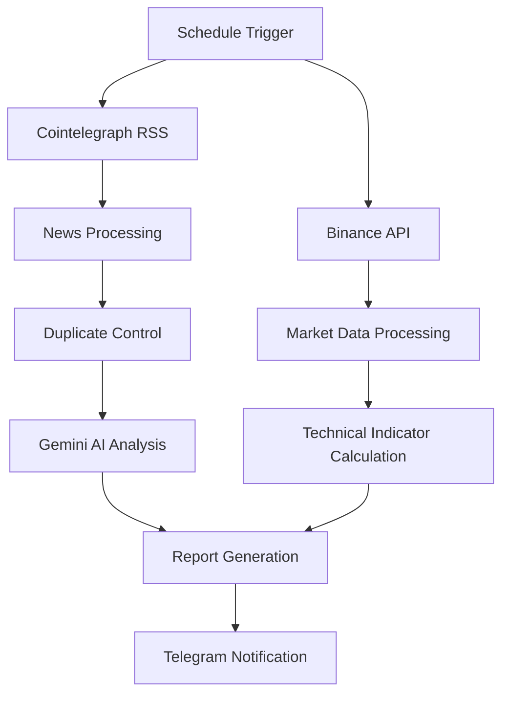
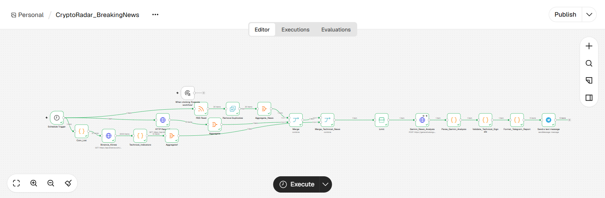
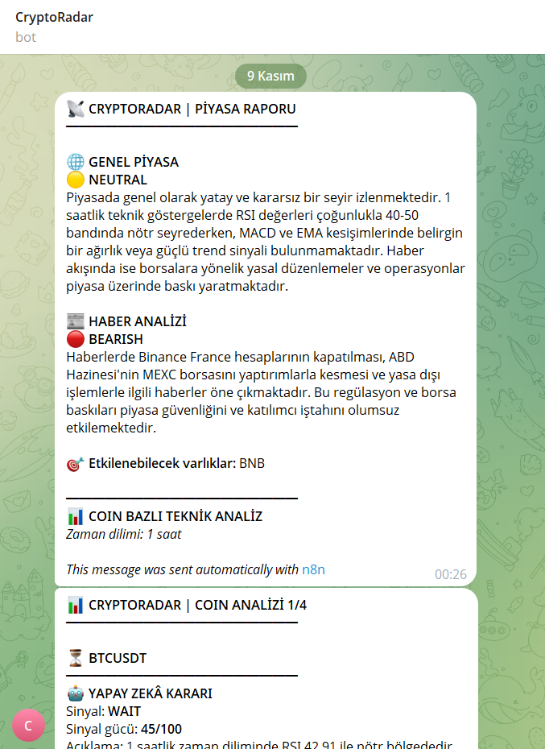
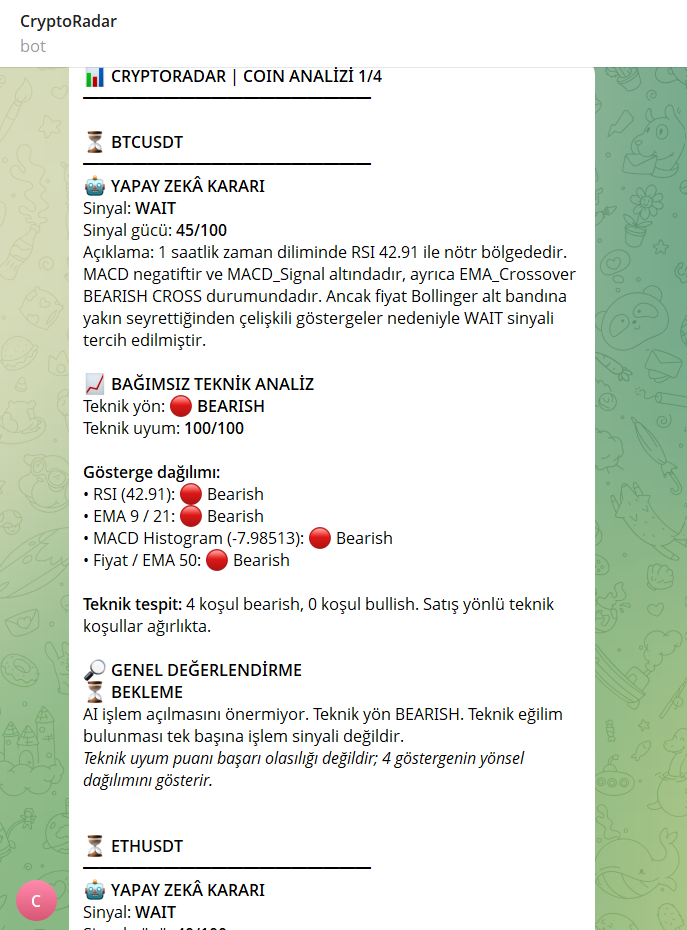

# 📡 CryptoRadar


**CryptoRadar**, n8n üzerinde geliştirilen, kripto para piyasalarını otomatik olarak takip eden ve yapay zekâ destekli analiz raporları oluşturan bir otomasyon projesidir.

Cointelegraph RSS üzerinden alınan haberleri, Binance piyasa verilerini ve Google Gemini analizlerini bir araya getirerek kullanıcıya Telegram üzerinden düzenli piyasa raporları sunar.

Proje; haber takibi, sentiment analysis, teknik gösterge hesaplamaları ve otomatik bildirim süreçlerini tek bir workflow içerisinde birleştirir.

✅ **Mimari:** Docker üzerinde çalışan self-hosted n8n otomasyon altyapısı  
✅ **AI Analiz:** Google Gemini ile haber analizi ve piyasa etkisi değerlendirmesi  
✅ **Piyasa Verisi:** Binance üzerinden kripto para fiyat ve mum verileri  
✅ **Bildirimler:** Telegram üzerinden otomatik piyasa raporları  
✅ **Hedef Kitle:** Algo-Traders, Quantitative Finance Meraklıları, Veri Bilimi Öğrenenler ve Otomasyon Geliştiricileri

---

## 🧠 Genel Bakış & Metodoloji

CryptoRadar, kripto para piyasalarından elde edilen farklı veri kaynaklarını otomatik olarak işleyerek anlamlı analiz çıktıları üretmek üzere tasarlanmıştır.

Sistemin çalışma metodolojisi üç temel aşamadan oluşur:

1. **📰 Otomatik Haber İzleme:** Cointelegraph RSS üzerinden güncel kripto para haberlerini toplar. Tekrar eden içeriklerin kontrol edilmesiyle aynı haberlerin yeniden işlenmesi önlenir.
2. **🤖 AI Destekli Analiz:** Google Gemini kullanılarak haberlerin piyasa üzerindeki olası etkileri değerlendirilir. Haberler sentiment, impact score, related assets ve reasoning gibi alanlarla analiz edilir.
3. **📊 Piyasanın Teknik Analizi:** Binance piyasa verileri üzerinden teknik göstergeler hesaplanır. Belirlenen koşullar ve doğrulama kontrolleri doğrultusunda teknik sinyaller oluşturulur.

Analiz sonuçları birleştirilerek Telegram üzerinden kullanıcıya iletilir.

---

## ⚙️ Başlıca Özellikler

- **Otomatik Haber İzleme:** Cointelegraph RSS üzerinden periyodik haber takibi.
- **AI Destekli Duygu Analizi:** Gemini ile haberlerin pozitif, negatif veya nötr olarak değerlendirilmesi.
- **Piyasa Etki Puanlaması:** Haberlerin piyasa üzerindeki olası etkilerinin puanlanması.
- **Çoklu Varlık İzleme:** Birden fazla kripto para paritesinin eş zamanlı takibi.
- **Technical Indicator Engine:** RSI, MACD, EMA ve Bollinger Bands gibi teknik göstergelerin hesaplanması.
- **Sinyal Doğrulama:** Teknik sinyallerin belirlenen koşullar ve tutarlılık kontrollerinden geçirilmesi.
- **Yinelenen Haberlerin Kontrolü:** Daha önce işlenen haberlerin tekrar değerlendirilmesinin önlenmesi.
- **Telegram Bildirimleri:** Haber analizleri ve teknik değerlendirmelerin otomatik raporlanması.
- **Self-Hosted Altyapısı:** Docker ve Docker Compose ile yerel ortamda çalıştırılabilen otomasyon altyapısı.
- **Ortam Tabanlı Yapılandırma
:** API anahtarları ve yapılandırma bilgilerinin ortam değişkenleri üzerinden yönetilmesi.

---

## 🏗️ Sistem Mimarisi

CryptoRadar, veri toplama, analiz ve bildirim aşamalarını n8n workflow yapısı içerisinde bir araya getirir.

### Workflow Önizleme


-Not: Diyagram sistemin genel mimarisini göstermektedir. Gerçek n8n workflow bağlantıları ve düğüm yapılandırmaları JSON dosyasında yer almaktadır.


## İşlem Akışı

| Aşama | Bileşen | Açıklama |
| :---: | :--- | :--- |
| 01 | Schedule Trigger | Workflow'un belirlenen zaman aralıklarında başlatılması |
| 02 | RSS Haber Kaynağı | Cointelegraph üzerinden haberlerin alınması |
| 03 | Binance API | Piyasa verilerinin ve mum grafiklerinin alınması |
| 04 | Veri İşleme | Toplanan verilerin düzenlenmesi ve işlenmesi |
| 05 | Duplicate Control | Daha önce alınan haberlerin tespit edilerek elenmesi |
| 06 | Gemini Yapay Zekâ | Haberlerin yapay zekâ ile analiz edilmesi |
| 07 | Teknik Analiz | Teknik göstergelerin hesaplanması | kullanıcıya iletilmesi


## 🖥️ Görsel Önizleme

### 1. Workflow Mimarisi

CryptoRadar otomasyonunun n8n üzerindeki genel görünümü.



### 2. Telegram Piyasa ve Teknik Analiz Raporu

Yapay zekâ destekli haber analizleri, genel piyasa değerlendirmeleri, teknik göstergeler ve otomatik sinyal sonuçlarının Telegram üzerinden sunulması.






## 🧰 Kullanılan Teknolojiler

| Bileşen | Teknoloji | Açıklama |
| :--- | :--- | :--- |
| Otomasyon Motoru | n8n | İş akışlarının oluşturulması ve otomasyonun yönetilmesi |
| Containerization | Docker | Uygulamanın yalıtılmış bir ortamda çalıştırılması |
| Servis Yönetimi | Docker Compose | Servislerin yapılandırılması ve yönetilmesi |
| Programlama Dili | JavaScript | Veri işleme ve özel analiz fonksiyonlarının geliştirilmesi |
| Yapay Zekâ Sağlayıcısı | Google Gemini | Yapay zekâ destekli haber analizi |
| Piyasa Verisi | Binance API | Kripto para piyasası ve mum verilerinin alınması |
| Haber Kaynağı | Cointelegraph RSS | Kripto para haber akışının alınması |
| Bildirim Servisi | Telegram Bot API | Otomatik analiz ve raporların gönderilmesi |
| Configuration | Ortam Değişkenleri | API anahtarları ve servis ayarlarının yönetilmesi |


## 📂 Proje Yapısı

```text
CryptoRadar-n8n/
│
├── workflows/
│   └── CryptoRadar_BreakingNews.json
│
├── screenshots/
│   ├── workflow-overview.png
│   ├── telegram-report.png
│   └── telegram-report2.png
│
├── .env.example
├── .gitignore
├── docker-compose.yml
└── README.md
```

### Dosya ve Klasör Açıklamaları
| Dosya / Klasör | Açıklama |
| :--- | :--- |
| `workflows/` | n8n iş akışlarının dışa aktarılan JSON dosyalarını içerir. |
| `screenshots/` | İş akışının ve Telegram raporlarının ekran görüntülerini içerir. |
| `.env.example` | Ortam değişkenleri için örnek yapılandırma dosyasıdır. |
| `.gitignore` | Git tarafından takip edilmemesi gereken dosya ve klasörleri belirtir. |
| `docker-compose.yml` | Docker servislerinin yapılandırılmasını ve yönetilmesini sağlar. |
| `README.md` | Projenin tanıtımını, kurulum adımlarını ve teknik dokümantasyonunu içerir. |


## 🚀 Kurulum ve Başlangıç

### Ön Gereksinimler

Projeyi çalıştırmadan önce aşağıdaki araçların ve hesapların hazır olması gerekir:

- [Docker Desktop](https://www.docker.com/products/docker-desktop/)
- Docker Compose
- [Google Gemini API](https://aistudio.google.com/)
- Telegram hesabı ve Telegram botu

**Not:** Projede kullanılan Binance herkese açık piyasa verisi uç noktaları için API anahtarı gerekmez.

### 1. Depoyu Klonlama

Projeyi bilgisayarınıza indirmek için aşağıdaki komutları çalıştırın:

```bash
git clone https://github.com/OmerFarukKarakoy/CryptoRadar-n8n.git
cd CryptoRadar-n8n
```

### 2. Configure Environment Variables
Proje ana dizinindeki .env.example dosyasını .env adıyla kopyalayın.
Windows PowerShell:
```bash
Copy-Item .env.example .env
```
Linux / macOS:
```bash
cp .env.example .env
```
.env dosyasını açarak kendi API ve yapılandırma bilgilerinizi girin.

Örnek yapılandırma:
```bash
GEMINI_API_KEY=your_gemini_api_key_here
GEMINI_MODEL=your_gemini_model
TELEGRAM_CHAT_ID=your_telegram_chat_id_here
```
Diğer örnek değişkenler için .env.example dosyasını inceleyebilirsiniz.

### 3. Start Docker Services
Aşağıdaki komut ile n8n servisini başlatın:

```bash
docker compose up -d
```

Servis durumunu kontrol edin:
```bash
docker compose ps
```

n8n arayüzüne aşağıdaki adres üzerinden erişebilirsiniz:
```bash
http://localhost:5678
```

### 4. Import n8n Workflow
1. n8n arayüzünü açın.
2. Gerekli kullanıcı hesabını oluşturun ve giriş yapın.
3. Workflow içe aktarma seçeneğini açın.
4. workflows/CryptoRadar_BreakingNews.json dosyasını seçin.
5. Workflow'un gerekli Credentials ve environment variable ayarlarını tamamlayın.
6. Workflow'u manuel olarak test edin.
Önemli: Workflow JSON dosyası içe aktarıldığında Telegram gibi servislerin Credentials bilgileri otomatik olarak oluşturulmaz. Bu bağlantılar n8n arayüzünde ayrıca yapılandırılmalıdır.

### 5. Execute Workflow
Gerekli yapılandırmalar tamamlandıktan sonra workflow'u test edebilir ve başarılı execution sonuçlarını inceleyebilirsiniz.


## 📈 Teknik Analiz Göstergeleri

CryptoRadar, piyasa verilerini değerlendirmek ve teknik sinyaller oluşturmak için çeşitli teknik analiz göstergelerinden yararlanır.

| Gösterge | Açıklama |
| :--- | :--- |
| RSI (14) | Göreceli Güç Endeksi kullanılarak fiyat momentumu değerlendirilir. |
| MACD | Hareketli ortalamalar üzerinden trend ve momentum analizi yapılır. |
| MACD Signal | MACD göstergesinin sinyal çizgisini temsil eder. |
| MACD Histogram | MACD çizgisi ile sinyal çizgisi arasındaki farkı gösterir. |
| EMA 9 / 21 / 50 / 200 | Farklı periyotlarda üstel hareketli ortalamalar hesaplanır. |
| EMA Crossover | Üstel hareketli ortalamaların kesişimleri değerlendirilir. |
| Bollinger Bands | Fiyatın volatilite bantlarına göre konumu analiz edilir. |

Teknik göstergeler, önceden tanımlanmış sinyal koşullarıyla birlikte değerlendirilir. Oluşturulan sinyaller kesin fiyat tahmini veya yatırım tavsiyesi niteliği taşımaz.


## 🔑 API ve Entegrasyon Yapılandırması

### Google Gemini

Google Gemini, haber içeriklerinin yapay zekâ destekli analizinde kullanılır.

- [Google AI Studio](https://aistudio.google.com/) üzerinden API anahtarı oluşturun.
- API anahtarını `.env` dosyasındaki `GEMINI_API_KEY` değişkenine ekleyin.
- Kullanmak istediğiniz model adını `GEMINI_MODEL` değişkeninde belirtin.

**Not:** Model erişimi ve ücretsiz kullanım limitleri Google tarafından belirlenir ve zaman içerisinde değişebilir.

### Binance API

Binance, teknik analiz için gerekli piyasa ve mum verilerini sağlar.

- Herkese açık piyasa verisi uç noktaları kullanılır.
- Fiyat ve OHLCV (Açılış, En Yüksek, En Düşük, Kapanış ve Hacim) verileri analiz sürecine aktarılır.
- Mevcut herkese açık piyasa verisi kullanımı için özel API anahtarı veya işlem yetkisi gerekmez.

### Telegram Entegrasyonu

Telegram, analiz sonuçlarının ve piyasa raporlarının kullanıcıya iletilmesi için kullanılır.

1. Telegram üzerinden [BotFather](https://t.me/BotFather) aracılığıyla bir bot oluşturun.
2. Oluşturduğunuz bot ile sohbet başlatın.
3. n8n içerisinden Telegram kimlik bilgileri (Credentials) yapılandırmasını tamamlayın.
4. Gerekli sohbet kimliğini `.env` dosyasındaki `TELEGRAM_CHAT_ID` değişkenine girin.

**Güvenlik Uyarısı:** Telegram bot anahtarınızı GitHub üzerinde veya herkese açık dosyalarda paylaşmayın. Bu bilgiyi güvenli şekilde n8n Credentials bölümünde saklayın.


## 🚧 Development Status

CryptoRadar, eğitim, araştırma ve yazılım geliştirme amacıyla oluşturulmuş bir projedir.

Mevcut sürüm; haber takibi, yapay zekâ destekli analiz, teknik gösterge hesaplamaları ve Telegram bildirim süreçlerini bir araya getirmektedir.

Proje, ilerleyen geliştirme aşamalarında yeni veri kaynakları, analiz yöntemleri ve otomasyon özellikleriyle genişletilebilir.

## ⚠️ Disclaimer

CryptoRadar yalnızca eğitim, araştırma ve piyasa verilerini analiz etme amacıyla geliştirilmiştir.

Oluşturulan haber analizleri, teknik sinyaller ve piyasa değerlendirmeleri yatırım tavsiyesi niteliği taşımaz.

Kripto para piyasaları yüksek volatilite ve finansal risk içerir. Otomatik analiz sonuçları hatalı, eksik veya gecikmeli olabilir. Herhangi bir yatırım kararı alınmadan önce kullanıcıların kendi araştırmalarını yapmaları gerekir.

CryptoRadar, mevcut hâliyle otomatik alım veya satım işlemi gerçekleştiren bir alım satım robotu değildir.

## 👨‍💻 Geliştirici

**Ömer Faruk Karaköy**

- GitHub: [@OmerFarukKarakoy](https://github.com/OmerFarukKarakoy)
- Depo: [CryptoRadar-n8n](https://github.com/OmerFarukKarakoy/CryptoRadar-n8n)

⭐ Projeyi faydalı bulduysanız GitHub üzerinden yıldız vererek destek olabilirsiniz.


**Not:** MIT lisansı eklemediğin için README'ye License rozeti koymadım. Dosyayı doğrudan GitHub'da `README.md` olarak kaydedebilirsin.
