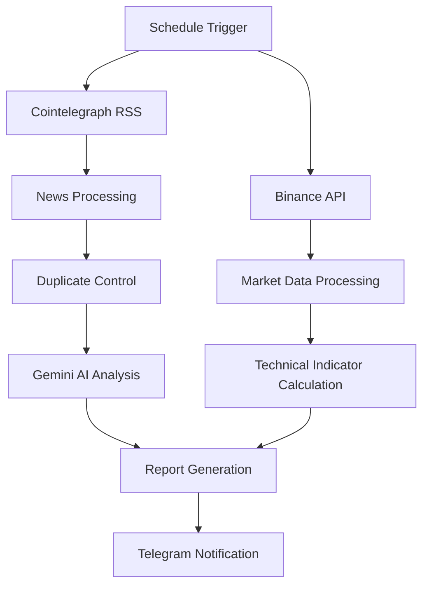

# 📡 CryptoRadar

**CryptoRadar**, n8n üzerinde geliştirilen, kripto para piyasalarını otomatik olarak takip eden ve yapay zekâ destekli analiz raporları oluşturan bir otomasyon projesidir.

Cointelegraph RSS üzerinden alınan haberleri, Binance piyasa verilerini ve Google Gemini analizlerini bir araya getirerek kullanıcıya Telegram üzerinden düzenli piyasa raporları sunar.

Proje; haber takibi, sentiment analysis, teknik gösterge hesaplamaları ve otomatik bildirim süreçlerini tek bir workflow içerisinde birleştirir.

✅ **Architecture:** Docker üzerinde çalışan self-hosted n8n otomasyon altyapısı  
✅ **AI Analysis:** Google Gemini ile haber analizi ve piyasa etkisi değerlendirmesi  
✅ **Market Data:** Binance üzerinden kripto para fiyat ve mum verileri  
✅ **Notifications:** Telegram üzerinden otomatik piyasa raporları  
✅ **Ideal for:** Algo-Traders, Quantitative Finance Enthusiasts, Data Science Learners ve Automation Developers

---

## 🧠 Overview & Methodology

CryptoRadar, kripto para piyasalarından elde edilen farklı veri kaynaklarını otomatik olarak işleyerek anlamlı analiz çıktıları üretmek üzere tasarlanmıştır.

Sistemin çalışma metodolojisi üç temel aşamadan oluşur:

1. **📰 Automated News Monitoring:** Cointelegraph RSS üzerinden güncel kripto para haberlerini toplar. Tekrar eden içeriklerin kontrol edilmesiyle aynı haberlerin yeniden işlenmesi önlenir.
2. **🤖 AI-Powered Analysis:** Google Gemini kullanılarak haberlerin piyasa üzerindeki olası etkileri değerlendirilir. Haberler sentiment, impact score, related assets ve reasoning gibi alanlarla analiz edilir.
3. **📊 Technical Market Analysis:** Binance piyasa verileri üzerinden teknik göstergeler hesaplanır. Belirlenen koşullar ve doğrulama kontrolleri doğrultusunda teknik sinyaller oluşturulur.

Analiz sonuçları birleştirilerek Telegram üzerinden kullanıcıya iletilir.

---

## ⚙️ Key Features

- **Automated News Monitoring:** Cointelegraph RSS üzerinden periyodik haber takibi.
- **AI-Powered Sentiment Analysis:** Gemini ile haberlerin pozitif, negatif veya nötr olarak değerlendirilmesi.
- **Market Impact Scoring:** Haberlerin piyasa üzerindeki olası etkilerinin puanlanması.
- **Multi-Asset Monitoring:** Birden fazla kripto para paritesinin eş zamanlı takibi.
- **Technical Indicator Engine:** RSI, MACD, EMA ve Bollinger Bands gibi teknik göstergelerin hesaplanması.
- **Signal Validation:** Teknik sinyallerin belirlenen koşullar ve tutarlılık kontrollerinden geçirilmesi.
- **Duplicate News Control:** Daha önce işlenen haberlerin tekrar değerlendirilmesinin önlenmesi.
- **Telegram Notifications:** Haber analizleri ve teknik değerlendirmelerin otomatik raporlanması.
- **Self-Hosted Infrastructure:** Docker ve Docker Compose ile yerel ortamda çalıştırılabilen otomasyon altyapısı.
- **Environment-Based Configuration:** API anahtarları ve yapılandırma bilgilerinin ortam değişkenleri üzerinden yönetilmesi.

---

## 🏗️ System Architecture

CryptoRadar, veri toplama, analiz ve bildirim aşamalarını n8n workflow yapısı içerisinde bir araya getirir.

### Workflow Overview

-Not: Diyagram sistemin genel mimarisini göstermektedir. Gerçek n8n workflow bağlantıları ve düğüm yapılandırmaları JSON dosyasında yer almaktadır.

## Processing Pipeline
Stage	Component	Description
01	Schedule Trigger	Workflow'un belirlenen zaman aralığında başlatılması
02	RSS Feed	Cointelegraph haberlerinin alınması
03	Binance API	Piyasa ve mum verilerinin alınması
04	Data Processing	Verilerin düzenlenmesi ve işlenmesi
05	Duplicate Control	Tekrar eden haberlerin kontrol edilmesi
06	Gemini AI	Haberlerin yapay zekâ ile analiz edilmesi
07	Technical Analysis	Teknik göstergelerin hesaplanması
08	Report Generation	Analiz sonuçlarının rapor formatına dönüştürülmesi
09	Telegram	Raporların kullanıcıya iletilmesi

